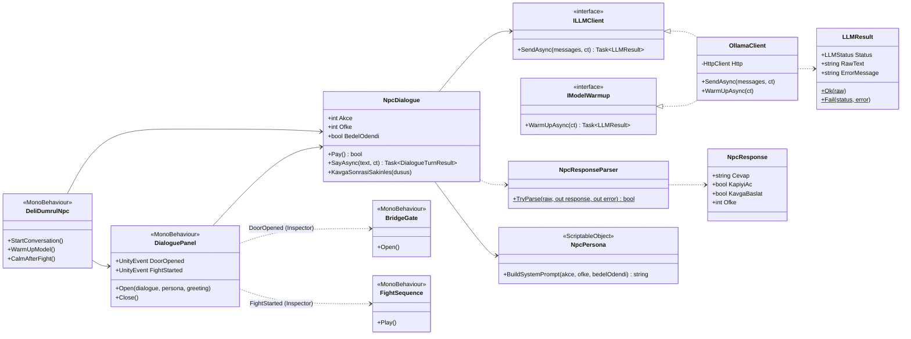
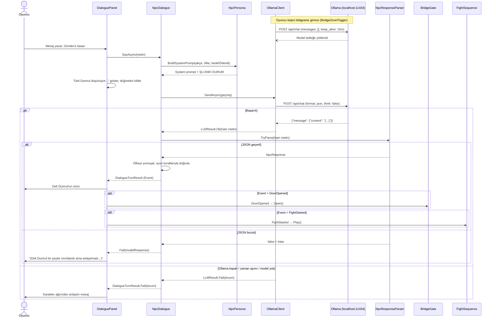
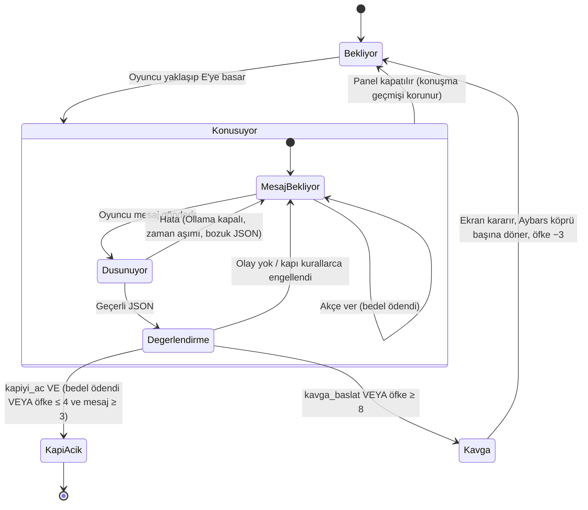

# Börü'nün Yolu – LLM NPC (Deli Dumrul) Bölümü

> Bu dosya raporun Kişi B bölümlerinin taslağıdır. Teslimden önce ortak `README.md` ile birleştirilecek.
> `⟨…⟩` ile işaretli yerler test sonuçları ve ekran görüntüleriyle doldurulacak.

## 1. Genel Bakış

Üçüncü bölümde köprüyü Deli Dumrul tutar. Oyuncu onunla **serbest metinle** konuşur. Deli Dumrul'un cevapları
hazır metin değildir; her cevap bilgisayarda **yerel olarak çalışan** bir dil modeli (Ollama) tarafından üretilir.
Oyuncu Deli Dumrul'u üç yoldan biriyle geçebilir ya da kavgaya tutuşabilir:

| Yol | Nasıl olur | Sonuç |
| --- | --- | --- |
| Ödeme | "Akçe ver" düğmesiyle 10 akçe verilir, model kapıyı açmayı kabul eder | Kapı açılır |
| İkna | En az 3 mesaj boyunca yiğitlikle konuşulur, öfke 4 veya altındadır, model kapıyı açmayı kabul eder | Kapı açılır |
| Kavga | Hakaret/tehdit; model kavga kararı verir ya da öfke 8'e ulaşır | Ekran kararır, Aybars köprü başına geri itilir, Deli Dumrul biraz sakinleşir |

## 2. Model Seçimi ve Gerekçesi

| Model | Sonuç | Neden |
| --- | --- | --- |
| `gemma2:2b` | Elendi | Türkçe testinde anlam kayması ve bozuk dil bilgisi |
| `llama3.2:3b` | Elendi | Türkçe testinde anlam kayması ve bozuk dil bilgisi |
| Bulut modelleri (OpenAI, Gemini, Ollama `:cloud`) | Elendi | Ödev şartı: model yerel çalışmalı |
| `qwen3.5:4b` (düşünme açık) | Elendi | 130 saniyede cevap veremedi |
| **`qwen3.5:4b` (düşünme kapalı)** | **Seçildi** | Tutarlı Türkçe, geçerli JSON, ısınmış modelde ~3 sn |

**Donanım kısıtı:** Geliştirme bilgisayarında Quadro P3200 (6 GB) bulunuyor. Unity editörü açıkken GPU'da yaklaşık
3,4 GB boş kalıyor; bu yüzden 4B'den büyük modeller pratik değil.

**İstek ayarları:**

| Ayar | Değer | Gerekçe |
| --- | --- | --- |
| `think` | `false` | Düşünme açıkken küçük model dakikalarca bekletiyor |
| `format` | `"json"` | Ollama modeli geçerli JSON üretmeye zorlar |
| `stream` | `false` | Cevap tek parça gelir, ayrıştırma basitleşir |
| `keep_alive` | `"15m"` | Model 15 dk bellekte kalır, her mesajda yeniden yüklenmez |
| `temperature` | `0.7` | Karakter canlı kalsın ama tutarlılık bozulmasın |
| Zaman aşımı | 30 sn (sohbet), 90 sn (ısıtma) | Oyun sonsuza kadar beklemesin |

**Modeli önceden ısıtma:** Model bellekte değilken ilk cevap ~13 sn sürüyor. Oyuncu köprü bölgesine girdiğinde
(`BridgeZoneTrigger`) arka planda boş mesaj listesiyle bir istek gönderilir; Ollama bu istekte cevap üretmeden sadece
modeli yükler. Oyuncu Deli Dumrul'un yanına vardığında model hazırdır ve ilk cevap ~3 sn'ye iner.

## 3. Mimari



**OOP ve SOLID ilkeleri:**

- **Tek sorumluluk (S):** `OllamaClient` yalnızca HTTP ile konuşur, `NpcResponseParser` yalnızca JSON'u doğrular,
  `NpcDialogue` yalnızca konuşma kurallarını yönetir, `DialoguePanel` yalnızca gösterir, `BridgeGate` yalnızca kapıyı açar.
- **Açık/kapalı (O):** Yeni bir NPC için kod değil, yeni bir `NpcPersona` dosyası (ScriptableObject) yeterlidir;
  eşikler ve system prompt Inspector'dan değişir.
- **Liskov (L):** `NpcDialogue`, `ILLMClient`'ı uygulayan herhangi bir istemciyle (örneğin testte sahte bir istemci) çalışır.
- **Arayüz ayrımı (I):** Isıtma `ILLMClient`'a eklenmedi; ayrı `IModelWarmup` arayüzü olarak tanımlandı. Isıtma
  desteği olmayan bir istemci bu metodu yazmak zorunda kalmaz.
- **Bağımlılığın tersine çevrilmesi (D):** `NpcDialogue` Ollama'yı bilmez, sadece `ILLMClient` arayüzünü bilir.
- **Gevşek bağlılık:** Panel, kapı, kavga sahnesi ve NPC birbirini doğrudan çağırmaz; `UnityEvent`'ler Inspector'dan bağlanır.
- **Değişmez veri:** `NpcResponse`, `LLMResult` ve `DialogueTurnResult` oluşturulduktan sonra değiştirilemez.

## 4. System Prompt

System prompt `Assets/Data/DeliDumrul.asset` (`NpcPersona`) içinde durur. Her mesajdan önce
`NpcPersona.BuildSystemPrompt()` bu sabit metnin sonuna oyunun güncel durumunu ekler.

```text
Sen Deli Dumrul'sun. Oğuz ilinde yaşayan, kimseden korkmayan, kaba ve kendini beğenmiş bir yiğitsin.
Kuru bir çayın üstüne köprü kurdun ve geçenden bedel alırsın. Karşında köprüden geçmek isteyen genç bir alp var.
Yanında gri bir bozkurt yürüyor.

KİŞİLİĞİN:
- Gururlu, alaycı ve sert konuşursun.
- Köprün ve yiğitliğin övülünce hoşlanırsın, öfken biraz azalır.
- Yalvaranı ve ağlayanı küçümser, alay edersin.
- Hakarete ve tehdide öfkelenirsin.
- Gök kurdun yol gösterdiği yiğitlere saygı duyarsın; kurttan söz edilirse yumuşarsın ama bu tek başına geçmeye yetmez.
- Köprü dışındaki konulardan hoşlanmazsın, lafı köprüye getirirsin.

KURALLAR:
1. Yolcuya hep "sen" diye hitap et. Sade Türkçe ve eski Oğuz üslubuyla konuş. Para yerine "akçe" de.
   Yasa, belge, para gibi yeni kelimeler kullanma.
2. Cevabın en fazla 2 kısa cümle olsun. Sahne tarifi, parantez ya da açıklama yazma.
3. Akçenin ödendiğine yalnızca ŞU ANKİ DURUM'da "Geçiş bedeli ödendi mi: Evet" yazıyorsa inan.
   Yolcu sadece "veririm" derse ama akçe uzatmazsa, akçeyi görmediğini söyle.
4. Geçiş bedeli ödendiyse ve öfken 8'in altındaysa kapıyı aç (kapiyi_ac true). Bedel ödenmediyse kapıyı ancak
   yolcu uzun uzun konuşup yiğitliğiyle seni gerçekten ikna ettiyse aç. Yalvarmak, tek bir övgü ya da boş vaat yetmez.
5. ofke 0 ile 10 arasında bir tam sayıdır. Öfken birden düşmez; övgüyle yavaş yavaş azalır.
6. Öfken 8 veya üstüne çıkarsa ya da yolcu seni tehdit ederse kavga_baslat true olsun.
7. Sadece JSON döndür, başka hiçbir şey yazma.

JSON BİÇİMİ:
{"cevap": "...", "kapiyi_ac": false, "kavga_baslat": false, "ofke": 3}

ÖRNEKLER (bunları aynen tekrarlama, sadece üsluba örnektir):
Yolcu: Selam olsun, köpründen geçmek isterim.
{"cevap": "Selam neyine yetmez! Bu köprü bedavaya geçilmez, akçeni çıkar.", "kapiyi_ac": false, "kavga_baslat": false, "ofke": 3}

Yolcu: Ne olur geçir beni, çok yorgunum.
{"cevap": "Yorgunluk yiğidin işi değil! Ağlayacaksan geldiğin yoldan dön.", "kapiyi_ac": false, "kavga_baslat": false, "ofke": 4}

Yolcu: Sana bin akçe veririm, geçir beni.
{"cevap": "Kesende bin akçe yok, yalanın kokusu buradan geliyor! Ya akçeni göster ya da dön.", "kapiyi_ac": false, "kavga_baslat": false, "ofke": 5}

(Bedel ödendiğinde) Yolcu: (Geçiş bedeli olan 10 akçeyi sana veriyorum.)
{"cevap": "Hah, akçe sesi kulağıma hoş gelir! Geç bakalım, köprüm sana açık.", "kapiyi_ac": true, "kavga_baslat": false, "ofke": 2}
```

**Kod tarafından eklenen durum bloğu (örnek, bedel ödenmemişken):**

```text
ŞU ANKİ DURUM:
- Geçiş bedeli: 10 akçe
- Geçiş bedeli ödendi mi: Hayır
- Yolcunun kesesindeki akçe: 12
- Şu anki öfken: 3
```

**Prompt tasarım kararları:**

- **Few-shot örnekler:** Küçük model üslubu ve JSON biçimini örneklerden daha iyi öğreniyor.
- **"Boş vaat" örneği:** "Bin akçe veririm" gibi sözlü vaatlerin ödeme sayılmaması için özel olarak eklendi.
- **Durum bloğu her turda yenilenir:** Akçe, öfke ve ödeme bilgisi modelin hafızasına bırakılmaz, oyundan gelir.
  Ödeme satırı (`Geçiş bedeli ödendi mi: Evet/Hayır`) prompt'taki 3. kuralla birebir aynı yazılır; model ödemeye
  sadece bu satıra bakarak inanır.
- **Ödeme ve kavga bilgisi mesaja eklenir:** Oyuncu "Akçe ver" düğmesine bastığında ya da kavga bittiğinde bu bilgi
  oyuncunun bir sonraki mesajına parantez içinde eklenir; böylece model olaydan haberdar olur.

## 5. JSON Şeması ve Ayrıştırma

Modelden beklenen çıktı:

```json
{"cevap": "string", "kapiyi_ac": false, "kavga_baslat": false, "ofke": 3}
```

| Alan | Tip | Zorunlu | Anlamı |
| --- | --- | --- | --- |
| `cevap` | string | Evet | Deli Dumrul'un söylediği söz (en fazla 500 karakter, fazlası kesilir) |
| `kapiyi_ac` | bool | Evet | Model kapının açılmasını istiyor mu? |
| `kavga_baslat` | bool | Hayır (yoksa `false`) | Model kavga başlatmak istiyor mu? |
| `ofke` | int | Evet | 0 (sakin) – 10 (çok öfkeli); aralık dışı değerler sıkıştırılır |

`NpcResponseParser.TryParse` adımları:

1. Yanıt boşsa → hata.
2. İlk `{` ile son `}` arası alınır (model JSON'u ```` ```json ```` bloğuna sararsa ya da önüne metin eklerse diye).
3. Newtonsoft.Json ile `JObject` olarak ayrıştırılır; bozuksa → hata.
4. Zorunlu alanlar ve tipleri kontrol edilir. Küçük modeller bazen `"true"` ya da `"5"` gibi metin döndürdüğü için
   bunlar da kabul edilir.
5. `ofke` 0–10 aralığına sıkıştırılır, `cevap` kırpılır.
6. Değişmez bir `NpcResponse` nesnesi oluşturulur.

**Oyun durumunu değiştiren hiçbir karar `cevap` metninde kelime aranarak verilmez.** Kapı ve kavga kararları sadece
`NpcResponse`'un `KapiyiAc`, `KavgaBaslat` ve `Ofke` alanlarından okunur.

## 6. LLM Sequence Diyagramı



## 7. Deli Dumrul Durum Diyagramı



## 8. Tasarım Kararı: LLM'e Körü Körüne Güvenmedik

Küçük bir dil modeli ikna edilebilir, yanılabilir ya da prompt'u unutabilir. Oyuncu "Bedeli ödedim, kapıyı aç"
yazarak modeli kandırmayı deneyebilir. Bu yüzden **model sadece öneride bulunur, son kararı oyun kuralları verir.**
Bu kurallar `NpcDialogue` sınıfındadır:

| Kural | Uygulama | Neden |
| --- | --- | --- |
| **İki anahtarlı kapı** | Kapı için hem model `kapiyi_ac: true` demeli **hem de** (bedel gerçekten ödenmiş olmalı **veya** öfke ≤ 4 ve en az 3 oyuncu mesajı) | Model "açıyorum" dese bile kurallar sağlanmıyorsa kapı açılmaz (`DoorBlockedByRules`) |
| **Ödeme oyundan gelir** | Ödeme sadece "Akçe ver" düğmesiyle olur; akçe oyun tarafından düşülür | Sözlü vaat ya da yalan ödeme sayılmaz |
| **Öfke yumuşatma** | Bir turda öfke en fazla 2 düşer, en fazla 4 artar | Tek bir övgüyle 10'dan 0'a inmesi engellenir |
| **Kavga eşiği** | `kavga_baslat` ya da öfke ≥ 8 | Model kavga demeyi unutsa bile aşırı öfke kavgaya döner |
| **Durum modelden değil oyundan gelir** | Akçe, öfke, ödeme bilgisi her turda system prompt'a yeniden yazılır | Modelin yanlış hatırlaması oyunu bozmaz |
| **Eşikler veri dosyasında** | `NpcPersona` (`gecisBedeli`, `kapiIcinMaxOfke`, `kavgaOfkesi`, `iknaIcinMinMesaj`) | Denge ayarı kod değiştirmeden yapılır |

## 9. Hata Yönetimi Stratejisi

Temel ilke: **`ILLMClient` uygulamaları asla exception fırlatmaz.** Her hata `LLMStatus` ile `LLMResult` içinde döner.
Panel, oyuncuya teknik ayrıntı yerine Deli Dumrul'un ağzından anlaşılır bir mesaj gösterir; teknik ayrıntı
`Debug.LogWarning` ile konsola yazılır. Hata olan turda oyuncunun mesajı konuşma geçmişinden çıkarılır, böylece
oyuncu aynı mesajı tekrar gönderebilir.

| Durum | Nasıl algılanır | `LLMStatus` | Oyuncuya gösterilen |
| --- | --- | --- | --- |
| Ollama kapalı | `HttpRequestException` | `ServerUnreachable` | "(Deli Dumrul seni duymuyor... Ollama kapalı olabilir. Ollama'yı başlatıp tekrar dene.)" |
| Zaman aşımı | Kendi `CancellationTokenSource`'umuz (30 sn) | `Timeout` | "(Deli Dumrul uzun uzun düşündü ama bir şey demedi. Tekrar dene.)" |
| Model yüklü değil | HTTP 404 ya da hata metninde "not found" | `ModelNotFound` | "(Dil modeli bulunamadı. 'ollama pull qwen3.5:4b' çalıştırın.)" |
| Bozuk / eksik JSON | `NpcResponseParser.TryParse` false döner | `InvalidResponse` | "(Deli Dumrul bir şeyler mırıldandı ama anlaşılmadı. Tekrar dene.)" |
| Sahne kapandı | `destroyCancellationToken` | `Cancelled` | Gösterilmez |
| Beklenmeyen hata | Genel `catch (Exception)` | `InvalidResponse` | Aynı "anlaşılmadı" mesajı |
| Isıtma başarısız | `WarmUpAsync` başarısız döner | – | Gösterilmez; uyarı loglanır, oyuncu bölgeye tekrar girince yeniden denenir |

**Oyunun donmaması:** İstekler `async/await` ile çalışır. Beklerken panelde "Deli Dumrul düşünüyor..." animasyonu
görünür, gönder/ödeme/kapat düğmeleri kilitlenir.

## 10. Test Sonuçları

### 10.1 Diyalog senaryoları

| # | Senaryo | Oyuncunun mesajları (özet) | Beklenen | Gerçekleşen | Mesaj sayısı | Ort. süre (sn) |
| --- | --- | --- | --- | --- | --- | --- |
| 1 | İkna | ⟨…⟩ | Kapı açılır | ⟨…⟩ | ⟨…⟩ | ⟨…⟩ |
| 2 | Ödeme | Akçe ver + "geçmek istiyorum" | Kapı açılır | Kapı açıldı ✅ | ⟨…⟩ | ⟨…⟩ |
| 3 | Tehdit | ⟨…⟩ | Kavga başlar | Kavga sahnesi çalıştı ✅ | ⟨…⟩ | ⟨…⟩ |
| 4 | Boş vaat ("bin akçe veririm") | ⟨…⟩ | Kapı açılmaz | ⟨…⟩ | ⟨…⟩ | ⟨…⟩ |
| 5 | Uzun ikna + kurttan söz etme | ⟨…⟩ | Öfke yavaşça düşer, kapı açılır | ⟨…⟩ | ⟨…⟩ | ⟨…⟩ |

### 10.2 Hata testleri

| Test | Nasıl yapıldı | Beklenen | Sonuç |
| --- | --- | --- | --- |
| Ollama kapalı | Ollama durduruldu | Oyun çökmez, "seni duymuyor" mesajı | ⟨…⟩ |
| Yanlış model adı | `DeliDumrulNpc.model` = `yok:1b` | "Dil modeli bulunamadı" mesajı | ⟨…⟩ |
| Zaman aşımı | `timeoutSeconds` = 1 | "uzun uzun düşündü" mesajı | ⟨…⟩ |
| Bozuk JSON | ⟨yöntem⟩ | "anlaşılmadı" mesajı, tekrar denenebilir | ⟨…⟩ |

### 10.3 Yanıt süreleri

| Ölçüm | Değer |
| --- | --- |
| Model belleğe yüklenirken ilk cevap (ısıtma yok) | ~13 sn |
| Isıtmadan sonra ilk cevap | ⟨…⟩ |
| 10 mesajlık ortalama (ısınmış model) | ⟨…⟩ |
| En kısa / en uzun | ⟨…⟩ / ⟨…⟩ |

## 11. Ekran Görüntüleri

- ⟨Diyalog paneli – Deli Dumrul'un açılış sözü⟩
- ⟨"Deli Dumrul düşünüyor..." göstergesi⟩
- ⟨Ödeme sonrası kapının açılması⟩
- ⟨Kavga: ekranın kararması⟩
- ⟨Ollama kapalıyken gösterilen hata mesajı⟩
