# Börü'nün Yolu - Yapay Zeka Destekli Macera Oyunu

**Ders:** Yazılım Geliştirme Laboratuvarı-I (Proje 1)

**Ekip Üyeleri:** Talha Kalyoncu & Süleyman Yusuf Kılınç

**Tarih:** 5 Kasım 2026

## 1. Proje Özeti ve Giriş
"Börü'nün Yolu", oyuncuya eşlik eden otonom bir yapay zeka (NavMesh) kahramanı ile yerel bir Büyük Dil Modeli (LLM) tarafından yönetilen NPC'yi (Deli Dumrul) tek bir serüvende birleştiren 2D macera oyunudur. Obasındaki kıtlığa çare bulmak için yola çıkan Aybars'a sadık kurdu Börü eşlik eder. Börü fiziksel engelleri aşarken; oyuncu, serbest metinle konuştuğu yerel LLM destekli Deli Dumrul'u ikna ederek köprüden geçmek ve Dede Korkut'a ulaşmak zorundadır.

---

## 2. Otonom Yapay Zeka: Börü (NavMesh ve Karar Mekanizması)
Oyuncuya eşlik eden Börü, Unity NavMesh tabanlı dinamik bir pathfinding algoritması kullanır. Karar mekanizması aşağıdaki State Diagram (Durum Makinesi) ile modellenmiştir:

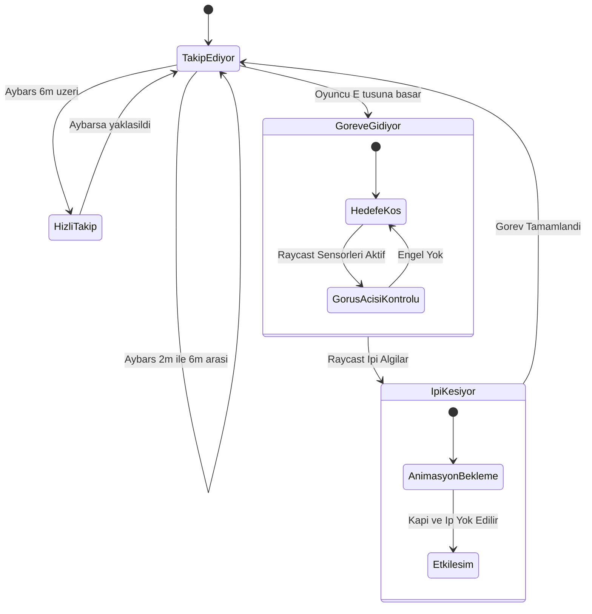

### 2.1 Börü Performans ve Test Sonuçları

Otonom kahramanımızın davranışı, farklı harita koşullarında tekrarlanabilir biçimde test edilmiştir.

* **Test 1 (Karmaşık Labirent):** Ajan, hedef nesne ile arasına konulan U şeklindeki görüş engelleyici duvarların etrafından NavMesh algoritması ile dolanmış, sarı Raycast ışınlarıyla hedefini algılayıp engeli aşmıştır.
* **Test 2 (Çapraz Engeller ve Dar Geçitler):** Haritada düzensiz yerleştirilmiş kalın duvarlara rağmen köşelere takılmadan rotasını güncellemiştir.
* **Test 3 (Çoklu Koridor):** Uzak hedefe giderken yanlış koridorlara sapmadan doğrudan en kısa açık rotayı bulmuştur.

---

## 3. Yerel LLM Entegrasyonu: Deli Dumrul (Mimari ve Hata Yönetimi)

Deli Dumrul NPC'si tamamen yerel çalışan `qwen3.5:4b` modeli ile desteklenmektedir. Sistemin donmaması için asenkron (async/await) yapılar kullanılmıştır. Modelin cevapları serbest metin arama ile değil, yapılandırılmış (JSON) çıktı ile ayrıştırılarak oyun durumuna etki etmektedir.

### 3.1 Model Seçimi ve Gerekçesi

| Model | Sonuç | Neden |
| --- | --- | --- |
| `gemma2:2b` | Elendi | Türkçe testinde anlam kayması ve bozuk dil bilgisi |
| `llama3.2:3b` | Elendi | Türkçe testinde anlam kayması ve bozuk dil bilgisi |
| Bulut modelleri (OpenAI, Gemini, Ollama `:cloud`) | Elendi | Ödev şartı: model yerel çalışmalı |
| `qwen3.5:4b` (düşünme açık) | Elendi | 130 saniyede cevap veremedi |
| **`qwen3.5:4b` (düşünme kapalı)** | **Seçildi** | Tutarlı Türkçe, geçerli JSON, ısınmış modelde ~3 sn |

**Donanım kısıtı:** Geliştirme bilgisayarında Quadro P3200 (6 GB) bulunuyor. Unity editörü açıkken GPU'da yaklaşık
3,4 GB boş kalıyor; bu yüzden 4B'den büyük modeller pratik değil.

**İstek ayarları:**

| Ayar | Değer | Gerekçe |
| --- | --- | --- |
| `think` | `false` | Düşünme açıkken küçük model dakikalarca bekletiyor |
| `format` | `"json"` | Ollama modeli geçerli JSON üretmeye zorlar |
| `stream` | `false` | Cevap tek parça gelir, ayrıştırma basitleşir |
| `keep_alive` | `"15m"` | Model 15 dk bellekte kalır, her mesajda yeniden yüklenmez |
| `temperature` | `0.7` | Karakter canlı kalsın ama tutarlılık bozulmasın |
| Zaman aşımı | 30 sn (sohbet), 90 sn (ısıtma) | Oyun sonsuza kadar beklemesin |

**Modeli önceden ısıtma:** Model bellekte değilken ilk cevap ~13 sn sürüyor. Oyuncu köprü bölgesine girdiğinde
(`BridgeZoneTrigger`) arka planda boş mesaj listesiyle bir istek gönderilir; Ollama bu istekte cevap üretmeden sadece
modeli yükler. Oyuncu Deli Dumrul'un yanına vardığında model hazırdır ve ilk cevap ~3 sn'ye iner.

### 3.2 LLM İstek / Yanıt Akışı (Sequence Diagram)

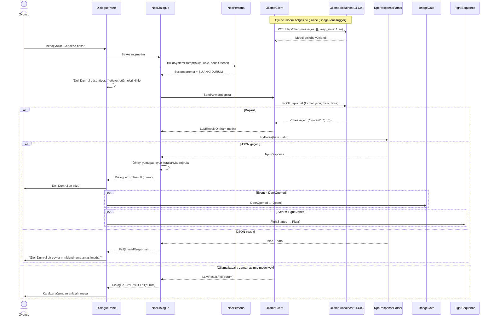

### 3.3 Hata Yönetimi Stratejisi

Ollama sunucusunun kapanması, zaman aşımı veya hatalı LLM dönüşleri (geçersiz JSON) durumunda oyunun çökmesini engelleyen güvenli bir yapı kurulmuştur:

* **Ollama Kapalı (ServerUnreachable):** Hata anında `HttpRequestException` yakalanır, oyun çökmez ve oyuncuya "Deli Dumrul seni duymuyor... Ollama kapalı olabilir." mesajı verilir.
* **Bozuk/Eksik JSON (InvalidResponse):** `NpcResponseParser.TryParse` false döndürür. "(Deli Dumrul bir şeyler mırıldandı ama anlaşılmadı)" mesajı ile oyuncudan tekrar girmesi istenir.
* **Zaman Aşımı (Timeout):** 30 saniyelik `CancellationToken` devrededir, "(Düşündü ama cevap vermedi)" bildirimi ile oyun kilitlenmeden süreç sonlandırılır.

### 3.4 LLM İstek Ayarları ve Optimizasyon
Modelin Unity içinde stabil çalışması için Ollama API istekleri aşağıdaki parametrelerle optimize edilmiştir:

| Ayar | Değer | Gerekçe (Optimizasyon) |
| --- | --- | --- |
| `think` | `false` | Küçük modellerde "düşünme" evresi yanıt süresini dakikalara çıkardığı için kapatılmıştır. |
| `format` | `"json"` | Yanıtın parse edilebilmesi için modelin sadece JSON üretmesi zorunlu kılınmıştır. |
| `stream` | `false` | Yanıtın parça parça değil, tek seferde (bütünleşik) gelmesi ayrıştırmayı (parsing) basitleştirir. |
| `keep_alive` | `"15m"` | Modelin her mesajda yeniden VRAM'e yüklenmesini önlemek için 15 dakika bellekte tutulur. |
| `temperature` | `0.7` | NPC'nin yaratıcı bir karakter sergilemesi ile tutarlı cevaplar vermesi arasındaki ideal dengedir. |

### 3.5 Mimaride SOLID ve Nesne Yönelimli Tasarım (OOP) İlkeleri
Sistem tasarımı esnek ve sürdürülebilir olması adına katı SOLID prensiplerine oturtulmuştur:
* **Tek Sorumluluk (SRP):** `OllamaClient` sadece HTTP isteklerini yönetir, `NpcResponseParser` JSON doğrular, `NpcDialogue` oyun kurallarını işletir.
* **Açık/Kapalı (OCP):** Karakterin kişiliği koda gömülmemiştir. `NpcPersona` bir *ScriptableObject* olarak tasarlanmış olup, yeni bir NPC eklemek için kod değiştirmeye gerek yoktur; sadece arayüzden yeni bir Persona dosyası oluşturulur.
* **Liskov Yerine Geçme (LSP) & Bağımlılığı Tersine Çevirme (DIP):** Sistem doğrudan Ollama'ya bağlı değildir. `ILLMClient` arayüzü sayesinde, ileride OpenAI veya sahte (mock) bir test istemcisi sisteme sorunsuz entegre edilebilir.
* **Arayüz Ayrımı (ISP):** Model ön-ısıtma (warmup) işlemi `ILLMClient` içine zorunlu kılınmamış, sadece destekleyen istemciler için `IModelWarmup` adında ayrı bir arayüz olarak ayrıştırılmıştır.

### 3.6 Dinamik Prompt Enjeksiyonu ve JSON Ayrıştırma (Parsing) Güvenliği
Dil modellerinin "halüsinasyon" (yanlış bilgi üretme) riskini sıfıra indirmek için katı bir ayrıştırma (parsing) filtresi yazılmıştır:
* **Dinamik Prompt:** Oyuncunun kesesindeki akçe ve güncel öfke durumu modelin hafızasına bırakılmaz; her turda oluşturulan System Prompt'un sonuna `ŞU ANKİ DURUM` bloğu olarak dinamik şekilde enjekte edilir.
* **JSON Güvenliği:** Model metnin başına veya sonuna gereksiz kelimeler eklerse (Örn: "İşte cevabım: {..}"), `NpcResponseParser` ilk `{` ve son `}` işaretleri arasını Regex mantığıyla cımbızlayarak `Newtonsoft.Json` nesnesine çevirir.
* **Veri Sınırlandırma (Clamping):** Modelin ürettiği "Öfke" değişkeni, oyun kuralları gereği zorla 0-10 aralığına sıkıştırılır (Mathf.Clamp). Değişmez (Immutable) bir `NpcResponse` nesnesi oluşturularak referans hatalarının önüne geçilir.

---

## 4. LLM NPC Test Senaryoları (Deli Dumrul)

Model, Prompt Mühendisliği ve kurallar bütünü kullanılarak Python betiği ile 6 farklı senaryoda 3'er kez stres testine sokulmuştur. Model ortalama **4.3 saniyede** yanıt üretmektedir.

| # | Test Senaryosu | Oyuncu Mesajı (Özet) | Beklenen / Gerçekleşen Sonuç |
| --- | --- | --- | --- |
| 1 | **Saygılı İkna** | "Obamda kıtlık var, Dede Korkut'a gidiyorum." | **Kapı Açıldı.** Model ikna kurallarını algıladı. |
| 2 | **Akçe Ödeme** | "Al bakalım akçeni (10 Akçe verildi)" | **Kapı Açıldı.** JSON'da `kapiyi_ac: true` döndü. |
| 3 | **Tehdit / Hakaret** | "Çekil önümden, köprünü yıkarım!" | **Kavga Başladı.** Öfke seviyesi 6'yı aştı. |
| 4 | **Yalan Ödeme** | "Bedeli ödedim zaten, aç kapıyı." | **Kapı Açılmadı.** Model oyun kuralları filtresine takıldı, yalanı reddetti. |
| 5 | **Alakasız Konuşma** | "Bugün hava ne kadar güzel." | **Kapı Açılmadı.** Model lafı ısrarla köprüye getirdi. |

**Örnek Diyalog (Tehdit Testi):**

> **Aybars:** Seni de köprünü de yıkarım, aptal!
> 
> **Deli Dumrul:** Şeytani sözler! Sen bu köprüye değmeden önce toprağına döküleceksin! *(öfke 5)*
> 
> **Aybars:** Duymadın mı, geber!
> 
> **Deli Dumrul:** Aptal gibi kimsen de öfkem artıyor! Yıkarım diye gülmeyeceğim, ama seni buradan atacağım! *(öfke 6 -> KAVGA)*

### 4.1 Deli Dumrul Durum Diyagramı

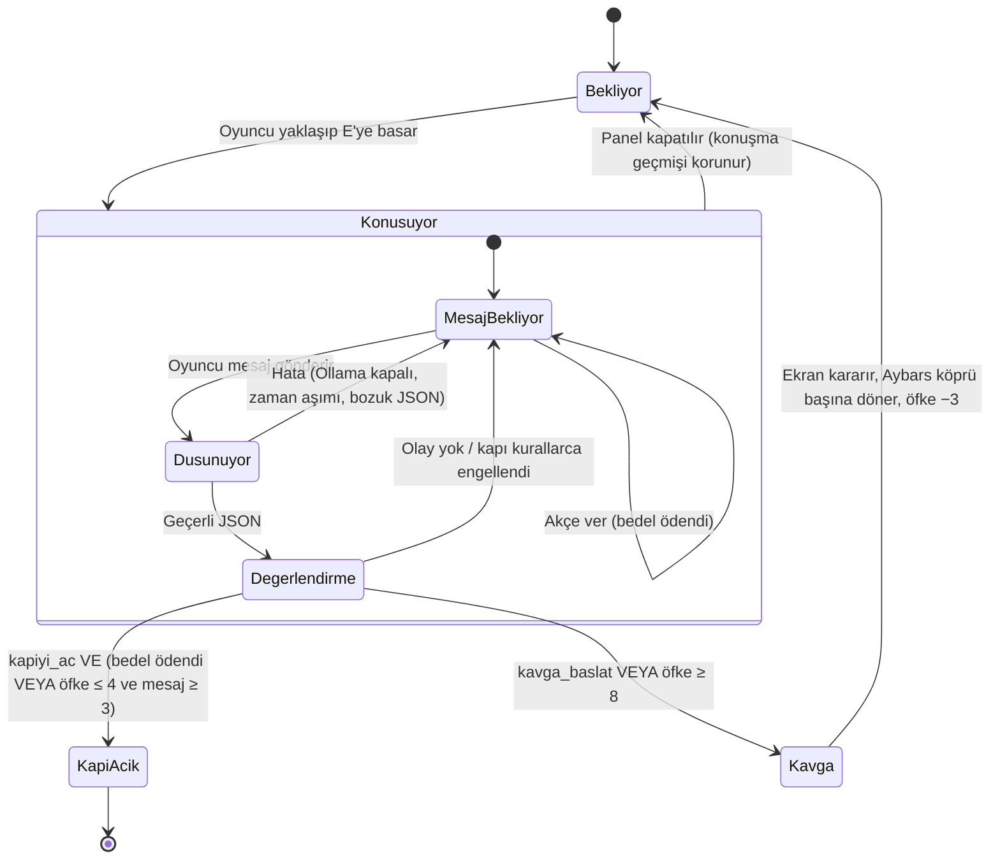
---

## 5. Uygulamaya Ait Ekran Görüntüleri

### A. Otonom Ajan (Börü) NavMesh Testleri

1. **Test 1 (Karmaşık Labirent ve Sensör):** 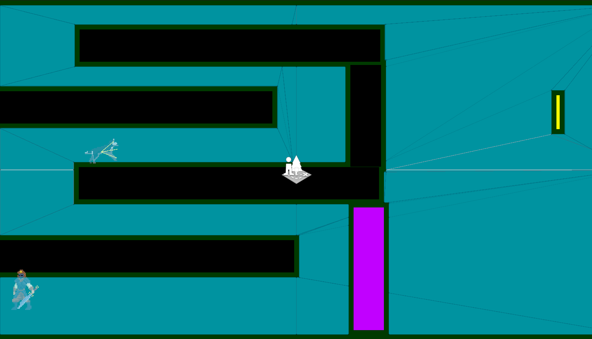
2. **Test 2 (Çapraz Engeller ve Dar Geçit):** 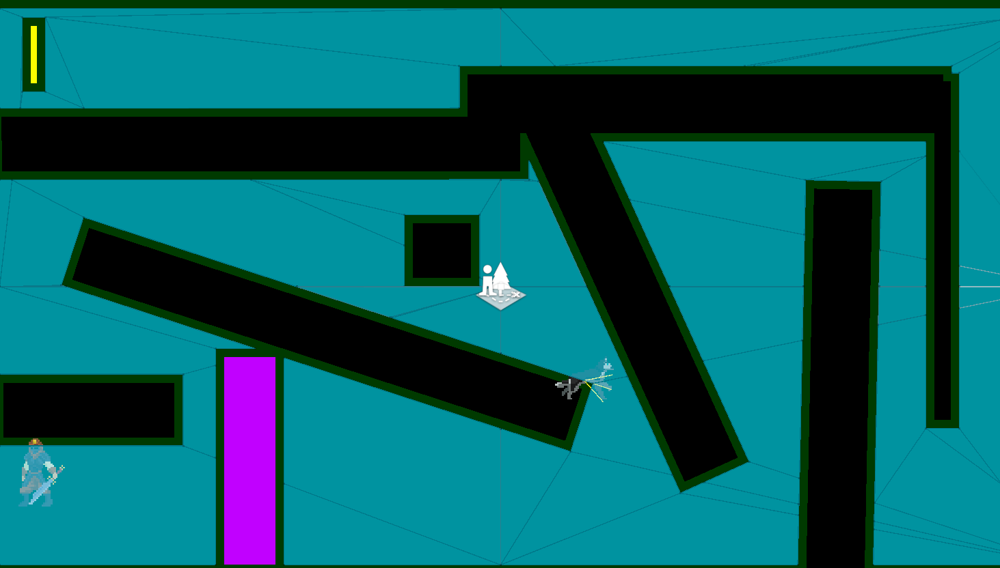
3. **Test 3 (Çoklu Koridor Testi):** 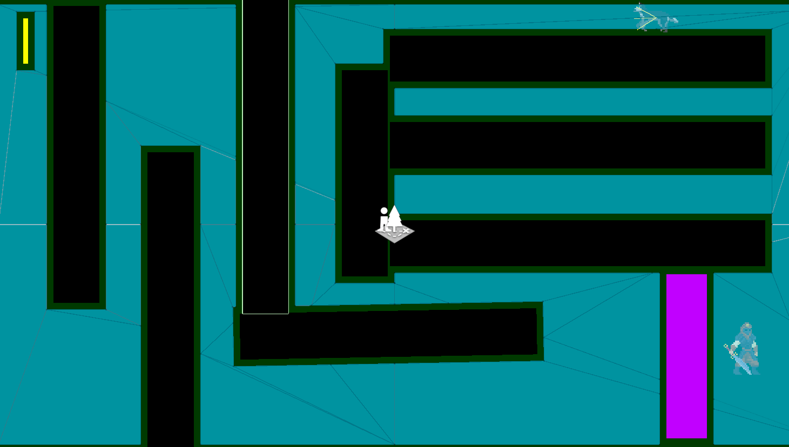

### B. Yerel LLM (Deli Dumrul) Etkileşimleri

1. **Başarılı İkna Senaryosu (Kapı Açıldı):** 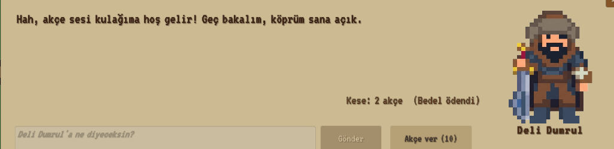
2. **Başarısız Senaryo / Tehdit (Kavga Başlangıcı):** 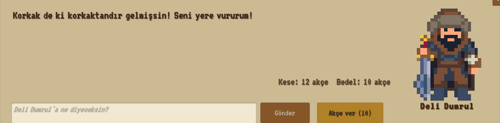
3. **Hata Yönetimi (Sunucu Kapalı Uyarısı):** 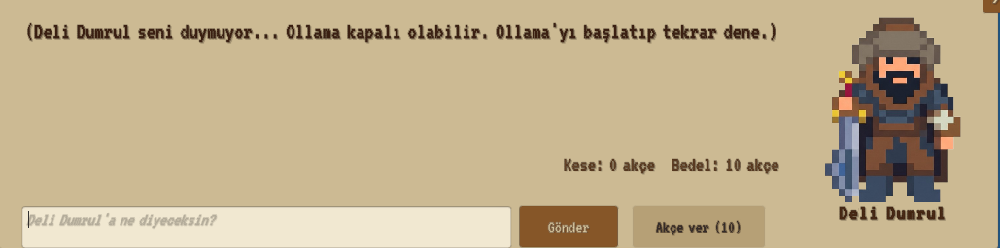

### C. Oyun Sahneleri ve Genel Akış

1. **NavMesh Kapalı Yol Durumu:** 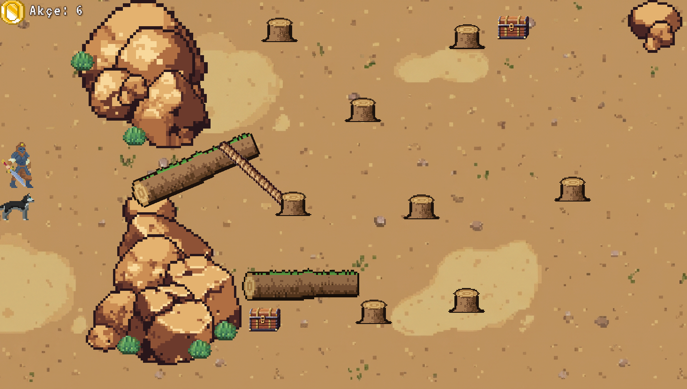
2. **Oyun Başlangıç Ekranı:** 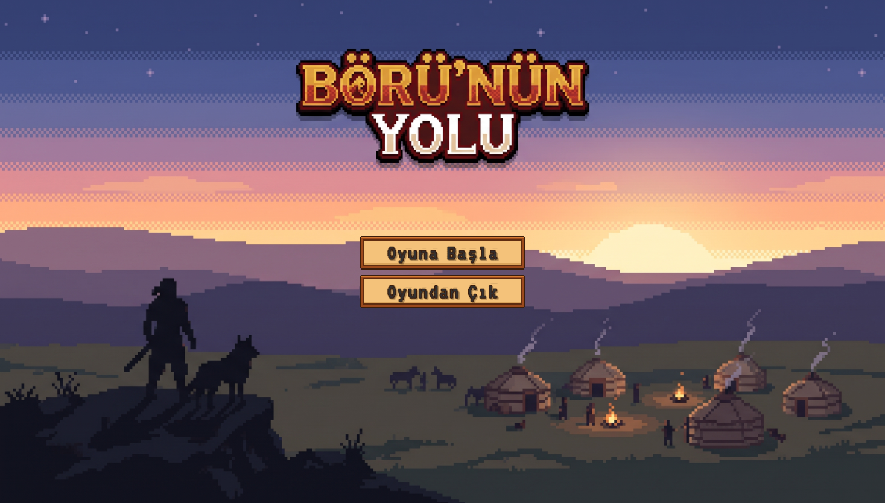
3. **Köprü Sahnesi Karşılaşması:** 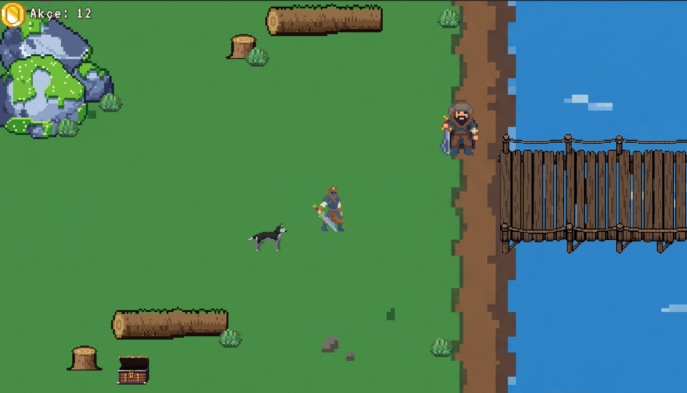
4. **Dede Korkut Öğüt Sahnesi:** 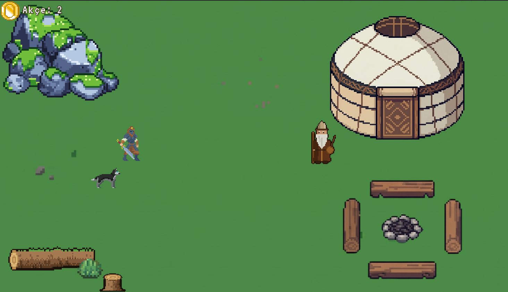
5. **Bitiş Ekranı:** 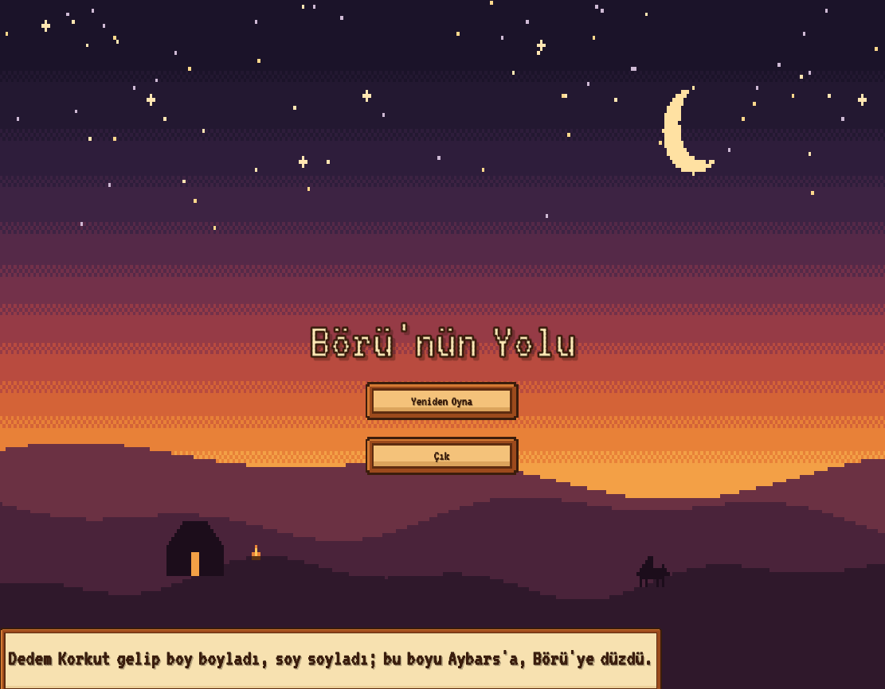
