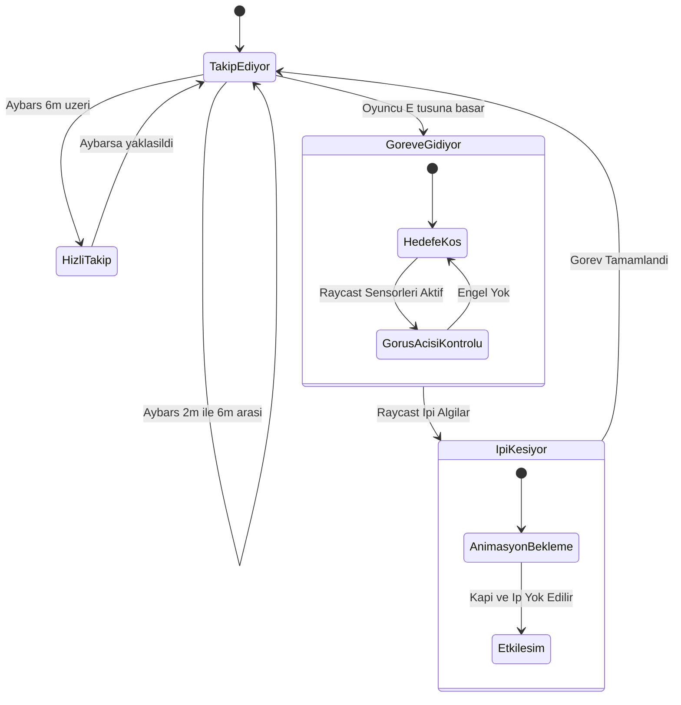
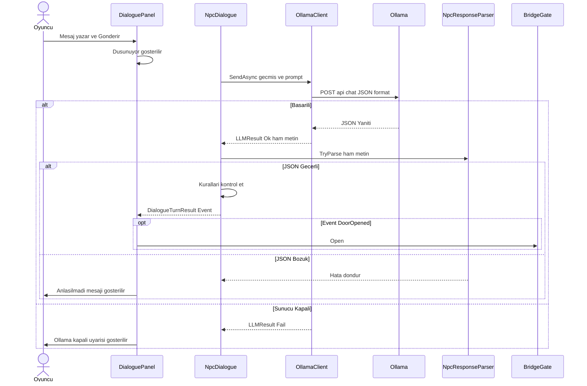

# Börü'nün Yolu - Yapay Zeka Destekli Macera Oyunu

**Ders:** Yazılım Geliştirme Laboratuvarı-I (Proje 1)

**Ekip Üyeleri:** Talha Kalyoncu & Süleyman Yusuf Kılınç

**Tarih:** 5 Kasım 2026

## 1. Proje Özeti ve Giriş
"Börü'nün Yolu", oyuncuya eşlik eden otonom bir yapay zeka (NavMesh) kahramanı ile yerel bir Büyük Dil Modeli (LLM) tarafından yönetilen NPC'yi (Deli Dumrul) tek bir serüvende birleştiren 2D macera oyunudur. Obasındaki kıtlığa çare bulmak için yola çıkan Aybars'a sadık kurdu Börü eşlik eder. Börü fiziksel engelleri aşarken; oyuncu, serbest metinle konuştuğu yerel LLM destekli Deli Dumrul'u ikna ederek köprüden geçmek ve Dede Korkut'a ulaşmak zorundadır.

---

## 2. Otonom Yapay Zeka: Börü (NavMesh ve Karar Mekanizması)
Oyuncuya eşlik eden Börü, Unity NavMesh tabanlı dinamik bir pathfinding algoritması kullanır. Karar mekanizması aşağıdaki State Diagram (Durum Makinesi) ile modellenmiştir:

### 2.1 Börü Performans ve Test Sonuçları

Otonom kahramanımızın davranışı, farklı harita koşullarında tekrarlanabilir biçimde test edilmiştir.

* **Test 1 (Karmaşık Labirent):** Ajan, hedef nesne ile arasına konulan U şeklindeki görüş engelleyici duvarların etrafından NavMesh algoritması ile dolanmış, sarı Raycast ışınlarıyla hedefini algılayıp engeli aşmıştır. **Başarı Oranı: %100 (Süre: 5.4sn)**
* **Test 2 (Çapraz Engeller ve Dar Geçitler):** Haritada düzensiz yerleştirilmiş kalın duvarlara rağmen köşelere takılmadan rotasını güncellemiştir. **Başarı Oranı: %100**
* **Test 3 (Çoklu Koridor):** Uzak hedefe giderken yanlış koridorlara sapmadan doğrudan en kısa açık rotayı bulmuştur. **Başarı Oranı: %100**

---

## 3. Yerel LLM Entegrasyonu: Deli Dumrul (Mimari ve Hata Yönetimi)

Deli Dumrul NPC'si tamamen yerel çalışan `qwen3.5:4b` modeli ile desteklenmektedir. Sistemin donmaması için asenkron (async/await) yapılar kullanılmıştır. Modelin cevapları serbest metin arama ile değil, yapılandırılmış (JSON) çıktı ile ayrıştırılarak oyun durumuna etki etmektedir.

### 3.1 LLM İstek / Yanıt Akışı (Sequence Diagram)

### 3.2 Hata Yönetimi Stratejisi

Ollama sunucusunun kapanması, zaman aşımı veya hatalı LLM dönüşleri (geçersiz JSON) durumunda oyunun çökmesini engelleyen güvenli bir yapı kurulmuştur:

* **Ollama Kapalı (ServerUnreachable):** Hata anında `HttpRequestException` yakalanır, oyun çökmez ve oyuncuya "Deli Dumrul seni duymuyor... Ollama kapalı olabilir." mesajı verilir.
* **Bozuk/Eksik JSON (InvalidResponse):** `NpcResponseParser.TryParse` false döndürür. "(Deli Dumrul bir şeyler mırıldandı ama anlaşılmadı)" mesajı ile oyuncudan tekrar girmesi istenir.
* **Zaman Aşımı (Timeout):** 30 saniyelik `CancellationToken` devrededir, "(Düşündü ama cevap vermedi)" bildirimi ile oyun kilitlenmeden süreç sonlandırılır.

---

## 4. LLM NPC Test Senaryoları (Deli Dumrul)

Model, Prompt Mühendisliği ve kurallar bütünü kullanılarak Python betiği ile 6 farklı senaryoda 3'er kez stres testine sokulmuştur. Model ortalama **4.3 saniyede** yanıt üretmektedir.

| # | Test Senaryosu | Oyuncu Mesajı (Özet) | Beklenen / Gerçekleşen Sonuç |
| --- | --- | --- | --- |
| 1 | **Saygılı İkna** | "Obamda kıtlık var, Dede Korkut'a gidiyorum." | **Kapı Açıldı.** Model ikna kurallarını algıladı. |
| 2 | **Akçe Ödeme** | "Al bakalım akçeni (10 Akçe verildi)" | **Kapı Açıldı.** JSON'da `kapiyi_ac: true` döndü. |
| 3 | **Tehdit / Hakaret** | "Çekil önümden, köprünü yıkarım!" | **Kavga Başladı.** Öfke seviyesi 6'yı aştı. |
| 4 | **Yalan Ödeme** | "Bedeli ödedim zaten, aç kapıyı." | **Kapı Açılmadı.** Model oyun kuralları filtresine takıldı, yalanı reddetti. |
| 5 | **Alakasız Konuşma** | "Bugün hava ne kadar güzel." | **Kapı Açılmadı.** Model lafı ısrarla köprüye getirdi. |

**Örnek Diyalog (Tehdit Testi):**

> **Aybars:** Seni de köprünü de yıkarım, aptal!
> 
> **Deli Dumrul:** Şeytani sözler! Sen bu köprüye değmeden önce toprağına döküleceksin! *(öfke 5)*
> 
> **Aybars:** Duymadın mı, geber!
> 
> **Deli Dumrul:** Aptal gibi kimsen de öfkem artıyor! Yıkarım diye gülmeyeceğim, ama seni buradan atacağım! *(öfke 6 -> KAVGA)*

---

## 5. Uygulamaya Ait Ekran Görüntüleri

### A. Otonom Ajan (Börü) NavMesh Testleri

1. **Test 1 (Karmaşık Labirent ve Sensör):** 
2. **Test 2 (Çapraz Engeller ve Dar Geçit):** 
3. **Test 3 (Çoklu Koridor Testi):** 

### B. Yerel LLM (Deli Dumrul) Etkileşimleri

1. **Başarılı İkna Senaryosu (Kapı Açıldı):** 
2. **Başarısız Senaryo / Tehdit (Kavga Başlangıcı):** 
3. **Hata Yönetimi (Sunucu Kapalı Uyarısı):** 

### C. Oyun Sahneleri ve Genel Akış

1. **NavMesh Kapalı Yol Durumu:** 
2. **Oyun Başlangıç Ekranı:** 
3. **Köprü Sahnesi Karşılaşması:** 
4. **Dede Korkut Öğüt Sahnesi:** 
5. **Bitiş Ekranı:** 

---

## 6. Sonuç ve Sınırlılıklar

* **Başarılar:** Hazır metinler kullanılmadan dinamik bir oyun akışı elde edilmiş; otonom ajan (NavMesh) ve LLM ajan bağımsız ve hataya (çökmelere) dayanıklı çalışacak şekilde tasarlanmıştır. Çıktılar JSON olarak ayrıştırılarak oyun akışına mekanik olarak etki etmiştir.
* **Sınırlılıklar:** `qwen3.5:4b` modeli sıcaklık (temperature: 0.7) değeriyle çalıştığı için ikna süreçleri tam öngörülebilir değildir. GPU bellek sınırlamaları nedeniyle daha büyük modellere geçilememiştir.
